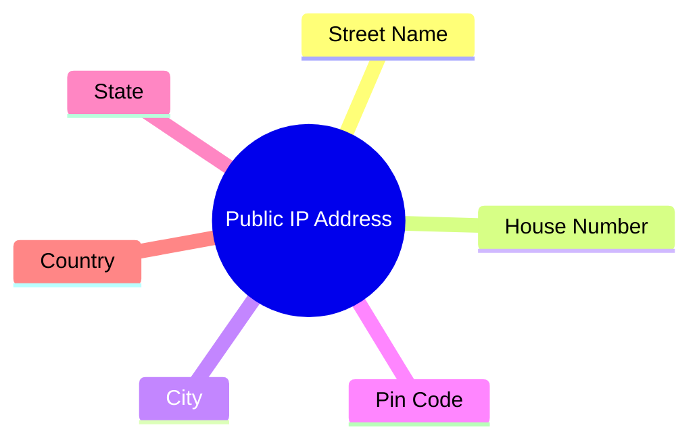
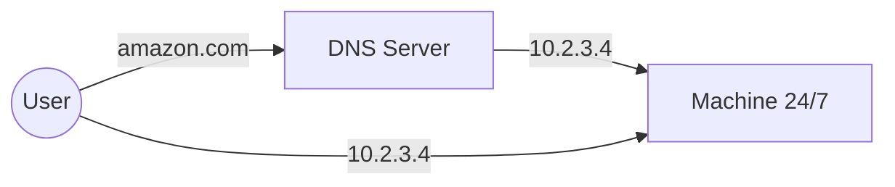
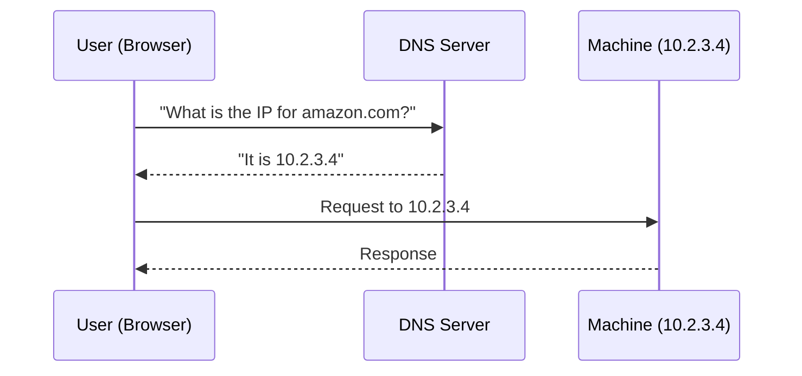
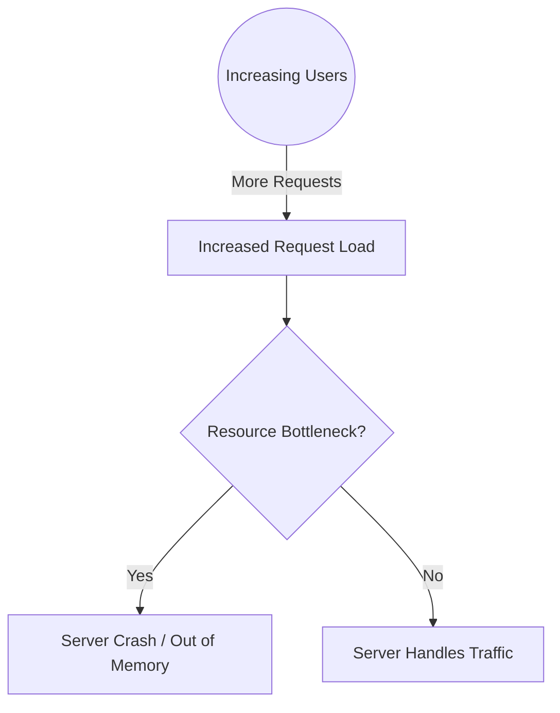
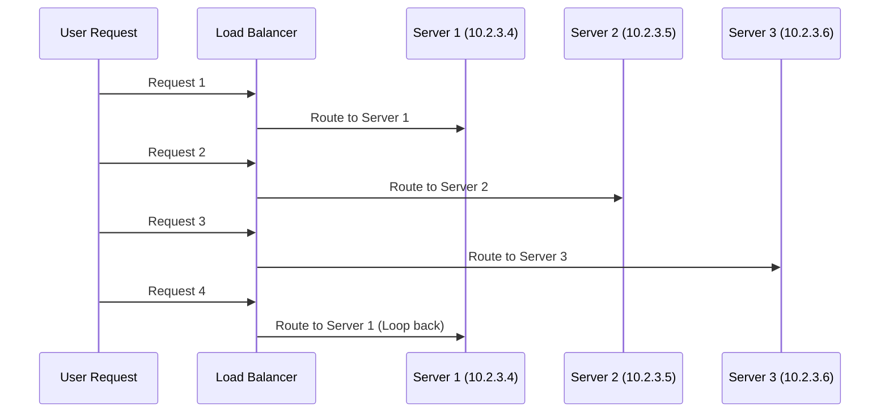
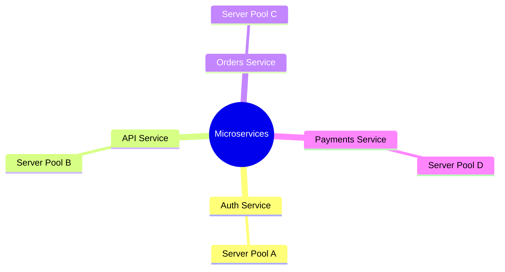
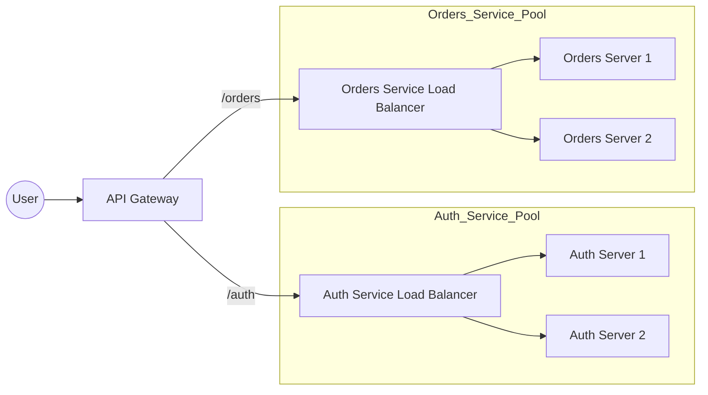

## System Design Components

- Overview of the key elements used to build scalable, production-ready systems:
    - Load balancers
    - API gateways
    - Caching
    - Queue systems and message brokers
    - High throughput systems
    - Microservices architecture
    - Container orchestration

### Roadmap for Building Robust Systems

- Topics to be explored for creating production-ready systems in a cloud environment:
    - **Load Balancing**
        - Application Load Balancers (ALB)
        - Network Load Balancers (NLB)
        - Determining use cases for each type
    - **Networking & Infrastructure**
        - Virtual Private Cloud (VPC)
    - **Traffic & Scaling Management**
        - Rate limiting techniques
        - Scaling strategies:
            - Scale out
            - Scale in

## Real-World Application: E-commerce Scale

- Using a massive e-commerce platform (like Amazon) as a case study for designing systems that handle global, high-volume traffic

### Understanding the Server

- A server is essentially a machine
    - It is designed to be capable of running 24/7 to provide continuous service

[00:02:07](https://www.youtube.com/watch?v=lFeYU31TnQ8&list=PLinedj3B30sBlBWRox2V2tg9QJ2zr4M3o&t=127s)

### Server Accessibility and Requirements

- To function as a server, a machine must be capable of running 24/7
- It requires a public IP address
    - This makes the machine publicly accessible, meaning anyone in the world can reach the server by typing in that IP address

[00:02:27](https://www.youtube.com/watch?v=lFeYU31TnQ8&list=PLinedj3B30sBlBWRox2V2tg9QJ2zr4M3o&t=147s)

- A server does not strictly need to be in the cloud
    - The cloud is essentially just someone else's machine
    - A personal computer or laptop can act as a server if it meets two criteria:
        - It has a continuous power connection
        - It is assigned a public IP address

### Transition to Cloud Computing

- While personal machines can act as servers, it is impractical for most users
    - Most people do not want to keep their personal laptops running 24/7
    - There are security concerns with connecting a personal machine directly to a public IP
- Cloud providers solve this by providing Virtual Machines
    - This allows for a server to be accessible via a public IP without using personal hardware

### Analogy: The Public IP Address

- A public IP address functions like a physical home address, providing a specific location for data to find a destination

| Address Component | Physical Equivalent |
| --- | --- |
| IP Address | House Number |
| Network Segment | Street Name |
| Regional Data | City / State / Country |

### DNS (Domain Name System)

- Because remembering numeric IP addresses (e.g., `10.2.3.4`) is difficult for humans, we use human-friendly names instead
    - Example: `amazon.com` is much easier to remember than a specific IP address
- **[What is it?]** A DNS server acts as a global directory
    - It maps user-friendly domain names to the actual IP addresses of the servers

[00:04:24](https://www.youtube.com/watch?v=lFeYU31TnQ8&list=PLinedj3B30sBlBWRox2V2tg9QJ2zr4M3o&t=264s)

### DNS Resolution Process

- A DNS server acts like a telephone directory
    - It maintains a record of which domain name corresponds to which IP address (e.g., `amazon.com` $\rightarrow$ `10.2.3.4`)
- **[The Process]** DNS resolution is the sequence of events that occurs when a user tries to access a website:

    1. The user types a domain name (e.g., `amazon.com`) into their browser
    2. The request is sent to the DNS server
    3. The DNS server looks up the domain and returns the associated IP address
    4. The user's device uses that IP address to send requests directly to the correct server and receive responses

[00:05:12](https://www.youtube.com/watch?v=lFeYU31TnQ8&list=PLinedj3B30sBlBWRox2V2tg9QJ2zr4M3o&t=312s)

### DNS Server Characteristics

- Operates in a decentralized way
- Serves as a global public directory to map domains to IP addresses

### Physical Reality of a Server

- Even when using cloud services, a server is ultimately a physical machine
- It is powered by specific hardware resources:
    - CPU (e.g., 2 CPUs)
    - RAM (e.g., 4 GB RAM)

[00:05:54](https://www.youtube.com/watch?v=lFeYU31TnQ8&list=PLinedj3B30sBlBWRox2V2tg9QJ2zr4M3o&t=354s)

### The Problem of Increasing Load

- As a system grows, the number of users increases, which directly increases the request load on the server
- **[The Bottleneck]** When the load exceeds the server's capacity, the existing physical resources can become a bottleneck
    - For example, if a server has only 2 CPUs and 4GB of RAM, it may not be enough to handle high traffic
- **[Consequences]** An overwhelmed server can crash
    - One common cause is running out of memory (OOM)
    - When a server crashes, the website becomes unavailable (server down)

[00:06:29](https://www.youtube.com/watch?v=lFeYU31TnQ8&list=PLinedj3B30sBlBWRox2V2tg9QJ2zr4M3o&t=389s)

### Scaling Up Server Resources

- To prevent a server from going down (being "not fault-tolerant"), the machine's capacity must be increased to handle expected traffic spikes
- **[Scaling Up]** One approach is to increase the physical resources of the existing machine
    - If a server with 2 CPUs and 4GB of RAM is insufficient, it can be upgraded to a more powerful configuration
    - For example, upgrading to 64 CPUs and 128GB of RAM allows the machine to handle significantly higher traffic

[00:07:24](https://www.youtube.com/watch?v=lFeYU31TnQ8&list=PLinedj3B30sBlBWRox2V2tg9QJ2zr4M3o&t=444s)

### Limitations of Vertical Scaling

- While upgrading a single machine can handle more traffic, it is not a perfect solution for global scale
    - If a massive influx of global users occurs, even a highly upgraded server might eventually crash
- **[The Over-provisioning Problem]** Attempting to anticipate every possible traffic spike by adding extreme resources is inefficient
    - For example, allocating 6,000 CPUs and 128,000 GB of RAM might prevent a crash, but it is a "dumb decision" in a real-world business context
    - This approach is impractical because traffic is rarely constant; most systems do not experience maximum load 24/7

[00:07:55](https://www.youtube.com/watch?v=lFeYU31TnQ8&list=PLinedj3B30sBlBWRox2V2tg9QJ2zr4M3o&t=475s)

- **[Traffic Patterns]** Real-world systems, such as Amazon, exhibit fluctuating traffic patterns rather than a steady, massive load
    - Designing for the absolute peak at all times leads to significant wasted resources and unnecessary costs

### Vertical Scaling

- **[The Inefficiency]** Over-provisioning resources to handle peak load leads to wasted capacity during low-traffic periods
    - Traffic is rarely constant; it fluctuates based on external factors (e.g., increasing during festival seasons, decreasing during a recession)
    - Allocating resources for the absolute peak 24/7 is a form of "over-optimization" that wastes money and resources
- **Definition**: Vertical scaling is the process of increasing the physical resources (CPU, RAM) of an existing server to handle more load

[00:08:52](https://www.youtube.com/watch?v=lFeYU31TnQ8&list=PLinedj3B30sBlBWRox2V2tg9QJ2zr4M3o&t=532s)

### Vertical Scaling Definition

- **[Also known as]** Scaling up
- **Definition**: Involves increasing the capacity or capabilities of a single hardware or software component
    - This is achieved by adding more resources to an existing server
    - Common resources added include:
        - CPU
        - RAM
        - Disk space

[00:09:13](https://www.youtube.com/watch?v=lFeYU31TnQ8&list=PLinedj3B30sBlBWRox2V2tg9QJ2zr4M3o&t=553s)

### Cloud Resource Efficiency

- Cloud providers (e.g., AWS) offer a more efficient alternative to massive vertical scaling
    - Instead of allocating excessive resources to a single machine to handle potential spikes, you can request exactly what is needed
    - **[Example]** A user might only require 2 CPUs and 4GB of RAM for their specific needs

[00:10:17](https://www.youtube.com/watch?v=lFeYU31TnQ8&list=PLinedj3B30sBlBWRox2V2tg9QJ2zr4M3o&t=617s)

### Dynamic Resource Allocation

- **[Analogy: The Restaurant Staff]**
    - Imagine a restaurant that needs to pay cooks
    - If you hire 10 cooks to prepare for a potential rush, you waste money on their salaries during slow periods
    - **[The Cloud Approach]** Instead, hire a minimum number of staff (e.g., 2 cooks) to cover baseline needs
    - Only increase the number of staff (resources) when an actual rush occurs
- **[Application to Servers]**
    - Start with a baseline of resources (e.g., 2 CPUs and 4GB of RAM)
    - Increase these resources only when the load/rush increases

[00:10:18](https://www.youtube.com/watch?v=lFeYU31TnQ8&list=PLinedj3B30sBlBWRox2V2tg9QJ2zr4M3o&t=618s)

- **[The Downside]** While vertical scaling is effective for handling increased load, it has inherent limitations

### The Downtime Constraint

- **[The Restart Requirement]** You cannot perform vertical scaling on a running machine
    - To add physical resources (CPU, RAM), the machine must be restarted
    - This process causes **downtime**, where the server is unavailable to users
- **[Impact of Traffic Spikes]** Downtime is highly problematic during sudden surges in demand
    - If a massive spike occurs (e.g., a major sale event starting at midnight), the server would have to shut down to upgrade resources, leaving users unable to access the service exactly when they need it most.

[00:11:21](https://www.youtube.com/watch?v=lFeYU31TnQ8&list=PLinedj3B30sBlBWRox2V2tg9QJ2zr4M3o&t=681s)

### The Zero Downtime Requirement

- **[The Problem with Downtime]** For massive platforms like Amazon, even a very short period of unavailability is unacceptable
    - If a major sale event (e.g., Big Billion Days) starts at a specific time, a sudden spike in traffic is expected
    - If the server has to shut down to scale up resources (adding CPU/RAM), it creates downtime exactly when the service is most needed
    - Even a 1-minute downtime is too much for services that require **0 downtime**

### Moving Beyond Vertical Scaling

- Because vertical scaling requires a machine restart to add physical resources, it is not a viable solution for high-availability systems
- To solve this, the strategy must shift away from scaling a single machine (vertical scaling) toward a different approach

### Horizontal Scaling

- **[The Concept]** Instead of increasing the capacity of a single machine, add more machines in parallel to handle the load
    - If the load on a server (e.g., IP `10.2.3.4`) increases, you can spin up additional servers alongside it
    - While a new machine may take time to become active, the original machine remains online, ensuring **zero downtime**

[00:13:01](https://www.youtube.com/watch?v=lFeYU31TnQ8&list=PLinedj3B30sBlBWRox2V2tg9QJ2zr4M3o&t=781s)

- **[Comparison]**

| Feature | Vertical Scaling | Horizontal Scaling |
| --- | --- | --- |
| Method | Upgrade existing machine (CPU/RAM) | Add more machines in parallel |
| Downtime | Required (machine must restart) | Zero (existing machines stay active) |
| Complexity | Simpler to implement | More complex (requires managing multiple nodes) |

### Horizontal Scaling Mechanics

- **[The Approach]** Instead of upgrading the physical resources of a single machine, you add more servers (replicas) to the pool
    - This allows for parallel processing of requests
    - It maintains zero downtime because existing machines remain active while new ones spin up

[00:13:37](https://www.youtube.com/watch?v=lFeYU31TnQ8&list=PLinedj3B30sBlBWRox2V2tg9QJ2zr4M3o&t=817s)

### The Traffic Distribution Problem

- **[The Challenge]** Adding more servers creates a complexity in how users reach the service
    - Each new server in a horizontal scaling setup has its own unique IP address (e.g., `10.2.3.4`, `10.2.3.5`, `10.2.3.6`)
    - When a user types a domain name like `amazon.com`, the DNS returns a specific IP address
    - **[The Bottleneck]** If the DNS only returns one IP, all global users will still be directed to that single server, defeating the purpose of horizontal scaling
- **[Core Question]** How can we map a single domain name to multiple IP addresses and effectively distribute incoming traffic across all available servers?

### The Load Balancer Solution

- **[The Concept]** To solve the problem of distributing traffic across multiple server replicas, a Load Balancer is introduced as an intermediary component
- **[How it works]** Instead of the DNS mapping a domain name (like `amazon.com`) to the IP of a specific server, it maps the domain to the IP of the **Load Balancer**
    - This creates a single, stable entry point for all incoming requests
    - All global traffic is routed to the Load Balancer first

[00:14:21](https://www.youtube.com/watch?v=lFeYU31TnQ8&list=PLinedj3B30sBlBWRox2V2tg9QJ2zr4M3o&t=861s)

- **[The Workflow]**

    1. User requests `amazon.com` via DNS
    2. DNS returns the Load Balancer's IP (e.g., `10.2.3.7`)
    3. The user's request is routed to the Load Balancer
    4. The Load Balancer distributes the request to one of the available server replicas

[00:14:36](https://www.youtube.com/watch?v=lFeYU31TnQ8&list=PLinedj3B30sBlBWRox2V2tg9QJ2zr4M3o&t=876s)

| Component | Role in Horizontal Scaling |
| --- | --- |
| DNS | Maps the domain name to the Load Balancer's IP address |
| Load Balancer | Receives all incoming traffic and distributes it to the server pool |
| Server Replicas | Receive processed requests from the Load Balancer and handle the actual workload |

### Load Balancing Mechanics

- **[Primary Function]** The Load Balancer's role is to distribute incoming requests across the available server replicas
    - This prevents any single server from being overwhelmed by too much traffic
    - It ensures the workload is balanced effectively throughout the server pool

### Load Balancing Algorithms

- **[The Concept]** Algorithms are used by the Load Balancer to decide which specific server should receive the next incoming request
- **Round Robin Algorithm**
        - This is a simple method where the Load Balancer distributes requests sequentially across the list of servers
        - The sequence follows a repeating pattern: 1st request $\rightarrow$ 1st server, 2nd request $\rightarrow$ 2nd server, 3rd request $\rightarrow$ 3rd server, and then it loops back to the 1st server
        - **[Goal]** It aims to distribute the load equally among all participating servers

- **[Scaling the Pool]** If traffic increases further, new server replicas can be spun up and added to the Load Balancer's rotation to increase total capacity

### Adding New Server Replicas

- **[The Registration Process]** When a new server is spun up to handle more traffic, it must be registered with the Load Balancer
- **[Health Checks]** Before the Load Balancer starts sending traffic to a newly added server, it performs a health check
    - **[Goal]** To verify the server is "healthy" (e.g., up and running for at least one minute)
    - **[Purpose]** This ensures the server is actually ready to process requests and prevents routing traffic to a server that is still booting or failing

[00:16:18](https://www.youtube.com/watch?v=lFeYU31TnQ8&list=PLinedj3B30sBlBWRox2V2tg9QJ2zr4M3o&t=978s)

### Elastic Load Balancer (ELB)

- **[Amazon's Implementation]** Amazon provides a managed service called the Elastic Load Balancer (ELB)
- **[Resilience and Reliability]** While a standard load balancer could potentially crash, an ELB is designed to be highly available
    - It utilizes a vast architecture of micro-machines, threads, and workers
    - This distributed internal structure allows it to handle massive traffic volumes efficiently and prevents it from becoming a single point of failure

[00:16:34](https://www.youtube.com/watch?v=lFeYU31TnQ8&list=PLinedj3B30sBlBWRox2V2tg9QJ2zr4M3o&t=994s)

### Vertical Scaling vs. Load Balancing

- **[Load Balancer Requirement]** Vertical scaling does not require a load balancer
    - Because you are only increasing the resources of a single machine
    - The server retains its single, existing IP address

### Microservice Architecture

- **[Definition]** A design pattern where a large application is broken down into multiple, specialized, and independent services
- **[Service Examples]**
    - **Auth Service**: Handles user authentication
    - **API Service**: Manages API requests
    - **Orders Service**: Manages order processing
    - **Payments Service**: Handles financial transactions
- **[Independent Scaling]** Each service operates on its own dedicated set of servers
    - This allows for granular horizontal scaling
    - For example, if the **Auth Service** experiences high traffic, you can scale out its specific server pool without affecting the Orders or Payments services

### Routing in Microservice Architectures

- **[Path-Based Routing]** Requests are directed to specific service pools based on the URL path
    - For example, a request to `amazon.com/auth` must be routed specifically to the **Auth Service** servers
    - This ensures that the specialized resources for that service are utilized for the correct task

[00:18:34](https://www.youtube.com/watch?v=lFeYU31TnQ8&list=PLinedj3B30sBlBWRox2V2tg9QJ2zr4M3o&t=1114s)

### Path-Based Routing Requirements

- **[Routing Logic]** To manage a microservice architecture, the system must route requests to the appropriate service based on the URL path
    - Requests to `amazon.com/auth` $\rightarrow$ **Auth Service**
    - Requests to `amazon.com/order/...` $\rightarrow$ **Orders Service**
    - Requests to `amazon.com/payment/...` $\rightarrow$ **Payments Service**
- **[The Routing Requirement]** To implement this, the system needs a server capable of routing requests based on either the host or the specific route path

[00:18:36](https://www.youtube.com/watch?v=lFeYU31TnQ8&list=PLinedj3B30sBlBWRox2V2tg9QJ2zr4M3o&t=1116s)

### Service-Level Load Balancing

- **[The Secondary Routing Problem]** Once a request is successfully routed to a specific service (e.g., the Auth Service), a new question arises: which specific server instance within that service's pool should handle the request?
- **[The Solution]** To manage this, each individual microservice can have its own dedicated Load Balancer
    - This Load Balancer sits between the main router and the service's server replicas
    - It ensures that traffic is distributed evenly across all available instances of that specific service

[00:19:21](https://www.youtube.com/watch?v=lFeYU31TnQ8&list=PLinedj3B30sBlBWRox2V2tg9QJ2zr4M3o&t=1161s)

### API Gateway

- **[Definition]** An API Gateway is a centralized component that manages and routes incoming requests to the appropriate microservices.
- **[Routing Logic]** It examines the request path to determine which service pool should handle the traffic:
    - `/auth` $\rightarrow$ **Auth Service**
    - `/orders` $\rightarrow$ **Orders Service**
    - `/payments` $\rightarrow$ **Payments Service**
- **[Role in Architecture]** It serves as the single entry point for the entire system, abstracting the internal microservice structure from the client.

[00:20:49](https://www.youtube.com/watch?v=lFeYU31TnQ8&list=PLinedj3B30sBlBWRox2V2tg9QJ2zr4M3o&t=1249s)

### API Gateway and Load Balancer Workflow

- **[Request Routing Flow]** The API Gateway acts as the orchestrator for incoming requests, directing them to the appropriate service-specific infrastructure:
    - The API Gateway examines the request path (e.g., `/auth`)
    - It points the request to the corresponding service's Load Balancer
    - The Load Balancer then assigns the request to a specific server instance within that service's pool

[00:20:51](https://www.youtube.com/watch?v=lFeYU31TnQ8&list=PLinedj3B30sBlBWRox2V2tg9QJ2zr4M3o&t=1251s)

